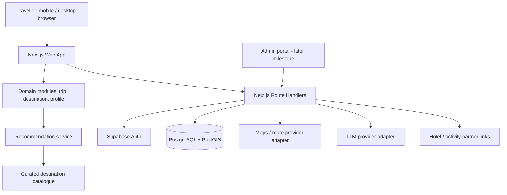

# Architecture (HLD)

## 1. Architecture choice

Use a modular Next.js application initially rather than splitting into separate frontend and NestJS services. This reduces deployment and operational overhead for a small MVP while preserving clear domain boundaries. Extract services only when scale or team boundaries justify it.

## 2. Logical architecture

## 3. Technology decisions

- Next.js App Router + React + TypeScript: responsive web UI and server endpoints.
- PostgreSQL + PostGIS: relational travel catalogue and geographic search.
- Supabase Auth: managed identity for MVP.
- Supabase Storage: approved destination media and user uploads if later needed.
- Maps provider adapter: Google Maps Platform or Mappls; choose after pricing, coverage, terms and attribution review.
- AI provider adapter: server-side only; use structured output constrained to known catalogue IDs.
- Vercel or equivalent: web hosting; database hosted separately through Supabase.

## 4. Trust boundary

Browser input is untrusted. Route handlers validate all requests. Database RLS protects user-owned records. Admin catalogue writes require a trusted server-side role. Third-party secrets remain server-side.

## 5. AI design

The AI should receive a bounded set of verified candidate records and user-provided trip constraints. It may explain trade-offs and draft a schedule using only supplied IDs. The application validates every returned ID and rejects unknown destinations/places/stays. Live prices, inventory, weather and route durations must come from their respective providers, not model knowledge.

## 6. Deployment environments

- Local: developer machine and seeded sample catalogue.
- Staging: separate Supabase project and preview deployment.
- Production: separate project, restricted secrets, backups, monitoring and domain.
- No production personal data in local fixtures.

## 7. Observability

Capture request IDs, server errors, recommendation latency and anonymized funnel events. Do not log auth tokens, full personal memory or precise location. Add provider usage and cost monitoring before enabling AI for public users.

## Travel media, journal, and publishing subsystem

Add three server-side modules alongside trip planning:

1. **Media service:** private Supabase Storage bucket, signed upload intents, object verification, image derivative processing, EXIF stripping, quotas, and retryable processing jobs. Video upload can be enabled independently once transcoding and storage budgets are defined.
2. **Journal service:** owner-scoped memories, tags, trip notes, expenses, and media associations. The journal is private by default and is not a public content feed.
3. **Story/publishing service:** provider-agnostic AI generation adapter, schema-validated editable drafts, explicit publish/unpublish, random public slugs, and a public read endpoint that returns an allow-listed projection only.

Public blog rendering must never make the private storage bucket or trip tables public. Public media are sanitized derivatives selected in `blog_media`; public pages are served through a narrow endpoint/view. All provider keys and storage service-role credentials remain server-side. Use a background job for image processing, generation retries, and PDF exports; use idempotency keys for upload completion and generation requests.

See `TRAVEL-JOURNAL-SPEC.md` and `database/002_travel_journal.sql` for detailed contracts and schema.
