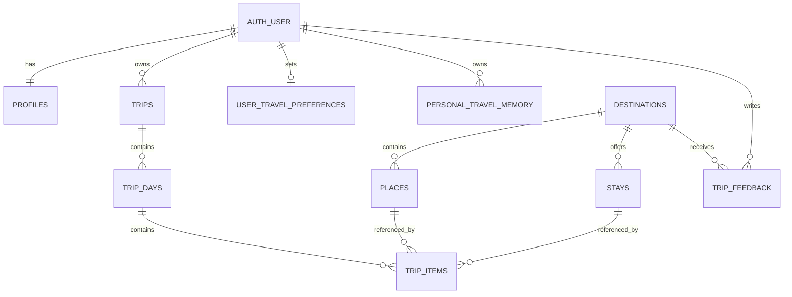

# Database design

The canonical initial DDL is `database/schema.sql`.

## Main entities

- `profiles`: public-facing profile fields linked to Supabase Auth.
- `destinations`: destination-level catalogue records and geographic point.
- `destination_tags`: searchable destination tags.
- `places`: attractions, hidden gems, food, activities and viewpoints.
- `stays`: accommodation and partner information.
- `trips`: a user's trip container and preferences.
- `trip_days`: one row per itinerary day.
- `trip_items`: ordered activities, stays, food and travel blocks.
- `user_travel_preferences`: explicit reusable preference settings.
- `trip_feedback`: private feedback by default; public display requires consent and moderation.
- `personal_travel_memory`: private user preference memory with source and consent timestamp.

## Relationship overview

## Important implementation notes

- Use PostGIS `geography(Point,4326)` for nearby-place queries and distance calculations.
- Store prices as integer INR minor units only if paise precision is required; this schema uses whole rupees for MVP estimates.
- Add `source_name`, `source_url`, `verified_at` and a verification owner/workflow to catalogue data as the dataset grows.
- Consider separate `price_observations` and `availability_observations` tables later; never overwrite historical observations without audit.
- Use soft-delete/archive behavior for destinations and stays after the admin workflow exists.
- RLS policies in the schema cover user-owned records. Admin writes must use a protected server-side role; do not expose service-role keys.
- Test RLS with two distinct user accounts before production.
